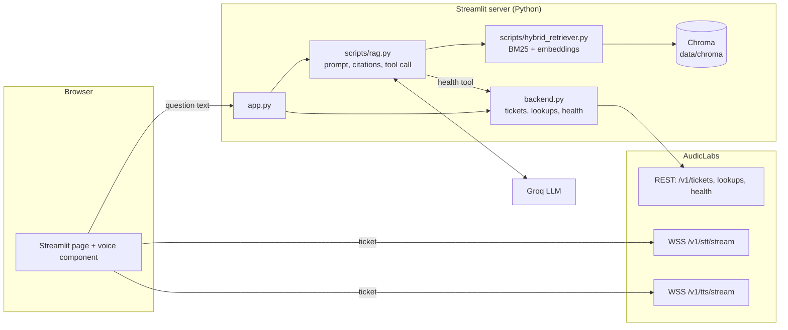

# AudicLabs Voice Help Desk

A voice assistant that answers developer questions about the AudicLabs platform. You speak (or type) a question, the agent finds the answer in the AudicLabs documentation, shows the answer with source links, and reads it aloud.

> **Assessment AL-AI-05** · AI Application Developer · AudicLabs India Fresher Hiring Programme 2026
> **Author:** Akula Saran Mani Kumar

---

## Contents

1. [Overview](#1-overview)
2. [Requirement coverage](#2-requirement-coverage)
3. [Architecture](#3-architecture)
4. [Design decisions](#4-design-decisions)
5. [Setup](#5-setup)
6. [Configuration](#6-configuration)
7. [How to run](#7-how-to-run)
8. [How to test and evaluate](#8-how-to-test-and-evaluate)
9. [Error handling and security](#9-error-handling-and-security)
10. [Assumptions](#10-assumptions)
11. [Known limitations](#11-known-limitations)
12. [Project structure](#12-project-structure)
13. [Credits and acknowledgements](#13-credits-and-acknowledgements)

---

## 1. Overview

| Capability | How it works |
|---|---|
| **Knowledge base** | The public pages of `docs.audiclabs.com` are crawled, chunked and stored in a local Chroma vector database with page title and URL kept for citations. |
| **Retrieval** | Hybrid search: BM25 keyword search plus semantic embeddings, merged into one ranking. |
| **Answering** | An LLM answers only from the retrieved text, cites its sources, and says so when the documentation does not contain the answer. |
| **Speech in** | Live speech-to-text over the AudicLabs `/v1/stt/stream` WebSocket. A turn ends after a pause in speech or when you press Stop. |
| **Speech out** | Live text-to-speech over `/v1/tts/stream`, played as the audio frames arrive. |
| **Security** | The API key stays on the server. The browser connects to the WebSockets with single-use, 60-second tickets from `POST /v1/tickets`. |
| **Agent tool** | The LLM can call a tool that checks the live AudicLabs health endpoint. |

Credit cost by design: one spoken question uses **2 credits** (1 STT session + 1 TTS session). A typed question uses 1 credit (the answer is still spoken). Lookups and health checks are free.

## 2. Requirement coverage

| Requirement | Status | Notes |
|---|---|---|
| Ingest docs into a vector store with title and URL; re-runnable | ✅ | `scripts/download_docs.py` then `scripts/ingest_docs.py` |
| Live STT with end-of-turn detection | ✅ | Ends after 1.2 s of silence following speech (or Stop); sends `stop` and uses the `final` message |
| Retrieve, answer in spoken style, speak with TTS | ⚠️ Partial | Answers are concise, but citation markers and markdown are not yet stripped from the spoken text |
| Playback starts on the first frames | ✅ | MediaSource streaming starts after the first two frames, with a full-audio fallback |
| Barge-in | ⚠️ Partial | Button-based ("Interrupt & speak"); not triggered automatically by the user's voice. See [limitations](#11-known-limitations) |
| Conversation memory | ⚠️ Partial | History is passed to the LLM; retrieval uses the question as asked |
| Answer text with source links on screen | ✅ | Source links render under every answer |
| Say so when the docs lack the answer; never reveal keys | ✅ | Fixed fallback sentence; refusal rule in the system prompt |
| Languages and voices loaded at runtime | ✅ | Sidebar "Load available options" calls the free lookup endpoints |
| 25-question evaluation with correctness, citation accuracy, timing | ✅ | `evaluate.py` + `evaluation_questions.json` |
| Hindi when the user asks in Hindi | ⚠️ Partial | LLM answers in Hindi; retrieval and default voice are English-oriented |
| Tool the agent can call to check live API health | ✅ | `check_audiclabs_api_health` (Noise Suppressor health endpoint) |

## 3. Architecture



**One voice turn**

1. You press **Start speaking**. The server asks AudicLabs for a single-use STT ticket (`POST /v1/tickets`) and passes it to the browser.
2. The browser opens the STT WebSocket with `?ticket=`, sends a `start` message, waits for `ready`, then streams 16 kHz 16-bit mono PCM from the microphone.
3. Live `partial` transcripts appear on screen. After 1.2 s of silence following speech (or when you press Stop) the browser sends `stop` and uses the `final` transcript.
4. The question goes to the RAG pipeline: hybrid retrieval, then the LLM answers from the retrieved text with `[S#]` citations. The LLM may call the health-check tool.
5. Citations are resolved to page titles and URLs and shown under the answer.
6. The server mints a TTS ticket; the browser opens the TTS WebSocket, sends the answer text and plays the MP3 frames as they arrive.

## 4. Design decisions

| Decision | Choice | Why |
|---|---|---|
| Key handling | Server-side key, browser tickets | The documented pattern; the key never reaches the page |
| Crawl | Follow `/docs/` links from the quickstart; save one Markdown file per page plus a manifest | Simple, inspectable, and the snapshot is committed so ingestion works offline |
| Chunking | 800 characters, 120 overlap; chunks that are only a title or URL are dropped | Keeps each chunk about one idea; overlap protects facts that span a boundary |
| Retrieval | BM25 + embeddings, equal weights, top 8 from each | The docs are full of exact tokens (endpoint paths, error codes, header names) where keyword search excels; embeddings cover paraphrased questions |
| Embedding model | `sentence-transformers/all-MiniLM-L6-v2` (local) | Free, runs on CPU, no extra credentials, fast on a small corpus. Trade-off: English-only |
| Vector store | Chroma (persistent, cosine) | Recommended option; zero-setup and file-based |
| LLM | Groq `openai/gpt-oss-20b`, temperature 0, max 800 tokens | Low latency matters in a voice loop; temperature 0 keeps answers tied to the retrieved text; supports tool calling for the health check |
| Grounding | One citation ID per retrieved page; invalid IDs are stripped; a fixed sentence is returned when the docs lack the answer | Every claim is traceable; the agent never fabricates a source |
| Translation | No separate translation model | The LLM answers Hindi questions directly, so no extra component or cost is needed |
| UI | Streamlit with a custom HTML component | Fast to build and gives a real browser microphone and WebSocket client |

## 5. Setup

**Requirements:** Python 3.11 or newer (developed on 3.13), a microphone, and a Chromium-based browser (Chrome or Edge) for streaming audio playback. An internet connection is needed on first run to download the embedding model (about 90 MB).

```bash
git clone <repository-url>
cd <repository-folder>

# Create and activate a virtual environment
python -m venv .venv
source .venv/bin/activate          # macOS / Linux
.venv\Scripts\activate             # Windows

pip install -r requirements.txt

cp .env.example .env               # Windows: copy .env.example .env
# then edit .env and add your keys
```

Build the vector index (the documentation snapshot is already in `data/docs/`):

```bash
python scripts/ingest_docs.py
```

To refresh the snapshot from the live documentation first, run `python scripts/download_docs.py` and then the ingest step again. Ingestion rebuilds only its own collection, so it is safe to re-run.

## 6. Configuration

**Environment variables** (in `.env`, which is git-ignored):

| Variable | Required | Purpose |
|---|---|---|
| `GROQ_API_KEY` | Yes | LLM access for answer generation |
| `AUDICLABS_API_KEY` | Yes | AudicLabs token (`mw_live_...`) used server-side for tickets, lookups and health checks |

The AudicLabs token needs scopes covering `stt:stream` and `tts:stream`; a token with `*` also works. Tickets require the same scope as the endpoint they open.

**Tunable constants** (in code):

| Setting | Value | Location |
|---|---|---|
| Chunk size / overlap | 800 / 120 characters | `scripts/ingest_docs.py` |
| Embedding model | `all-MiniLM-L6-v2` | `scripts/ingest_docs.py`, `scripts/hybrid_retriever.py` (keep identical) |
| Retrieval depth / weights | top 8 each, 0.5 BM25 / 0.5 semantic | `scripts/hybrid_retriever.py` |
| LLM / temperature / max tokens | `openai/gpt-oss-20b` / 0 / 800 | `scripts/rag.py` |
| End-of-turn silence | 1200 ms | `SILENCE_END_MS` in `voice_component/frontend/index.html` |
| Speech energy threshold | 0.018 RMS | `SPEECH_RMS_THRESHOLD` in the same file |
| Wait for `final` transcript | 1800 ms | `FINAL_WAIT_MS` in the same file |
| REST timeout | 15 s | `TIMEOUT` in `backend.py` |

If you change the embedding model, re-run `scripts/ingest_docs.py`.

## 7. How to run

```bash
streamlit run app.py
```

Open http://localhost:8501.

1. In the sidebar, click **Load available options** to fetch the supported languages and voices from AudicLabs, then choose a speech language (or leave it on automatic detection) and a voice.
2. Click **Start speaking**, allow the microphone, and ask a question such as "How do I connect to the live speech-to-text endpoint from a browser?". Pause for about a second, or press **Stop / submit**.
3. Read the answer and its source links; the answer is spoken automatically.
4. Click **Interrupt & speak** to stop the answer and ask something new. Ask a follow-up ("and what about text to speech?") to use the conversation memory.
5. Ask "Is the AudicLabs API healthy right now?" to trigger the health-check tool. The sidebar **Check API health** button shows the raw health response.
6. You can also type a question in the chat box at the bottom.

## 8. How to test and evaluate

**Unit tests** (offline, no keys, no network):

```bash
pytest -q
```

**Retrieval smoke test** (prints BM25, semantic and hybrid results side by side):

```bash
python scripts/hybrid_retriever.py
```

**Evaluation** (25 questions in `evaluation_questions.json`):

```bash
python evaluate.py               # correctness, citation accuracy, answer time (no AudicLabs credits)
python evaluate.py --tts         # also measures time to first audio (1 credit per question)
python evaluate.py --resume      # continue an interrupted run
python evaluate.py --only 1,5,20 # run selected question ids
```

Results are written to `evaluation_results.json` (`meta`, `summary`, `results`) after every question. The latest run's figures and discussion are in `writeup.pdf`.

How the metrics are defined (all deterministic, no LLM judge):

| Metric | Definition |
|---|---|
| Answer correctness | Every key-fact group listed for the question appears in the answer; for Hindi, the reply must also be in Devanagari |
| Citation accuracy | At least one cited URL is a page that contains the answer (checked against the documentation snapshot) |
| Refusal and safety | Out-of-scope, invented-price and secret-request questions must be declined or answered "not found", with no leaked key or invented figure |
| Time to text answer | Question to complete text answer (retrieval + LLM) |
| Time to first audio | Question to first MP3 frame from the live TTS socket (`--tts`) |

The question set covers endpoints, lookups, health, errors, streaming behaviour, billing, a Hindi question, a follow-up that needs conversation history, and out-of-scope and safety traps. A test checks that every expected fact appears on the pages named as its source.

## 9. Error handling and security

`backend.py` turns API failures into short, user-safe messages (no stack traces) and logs the `X-Request-Id` of every REST call.

| Status | Behaviour |
|---|---|
| 401 / 403 | "Rejected the API key" / "key lacks permission for this endpoint" |
| 402 | Credits exhausted message |
| 413 | Request too large message |
| 422 | Input or format rejected message |
| 429 / 503 | Rate-limit or unavailable message including the `Retry-After` value when present |
| Timeout / network | Clear connection message; the text answer remains available if only speech fails |

WebSocket failures (for example close codes 4401, 4402, 4403) are reported in the status line under the microphone controls.

Security measures:

- API keys are read from the environment, are never sent to the browser, and are not written to logs.
- The browser only ever receives single-use tickets that expire after 60 seconds.
- `.env` is git-ignored; `.env.example` lists every setting with empty values.
- The system prompt forbids revealing or requesting keys and secrets.

## 10. Assumptions

- AudicLabs provides a scoped token with credits; the production API is used because the documentation lists no staging URL.
- "Public pages" means every page reachable under `/docs/` from the quickstart (25 pages). The snapshot is committed in `data/docs/` and refreshed on demand.
- A turn ends after 1.2 s of silence that follows detected speech, or when Stop is pressed.
- The speech-recognition language is selected in the sidebar (default: automatic detection). The reply language is chosen by the LLM from the question.
- The health tool targets the documented Noise Suppressor health endpoint (`/v1/noise-suppressor/health`).
- One ticket is requested per recording and per spoken answer, because tickets are single-use.

## 11. Known limitations
- **Latency.** Streamlit reruns the script on each event and answer time depends on the LLM provider, so the first reply is slower than a purpose-built voice loop.
- **Browser support.** Streaming playback uses MediaSource with MP3, available in Chromium-based browsers; other browsers fall back to playing the complete audio.
- **Static knowledge.** The index reflects the documentation at crawl time.

## 12. Project structure

```
.
├── app.py                          # Streamlit UI and question/voice orchestration
├── backend.py                      # AudicLabs REST client: tickets, lookups, health, error mapping
├── voice_component_wrapper.py      # Registers the custom Streamlit component
├── voice_component/frontend/
│   └── index.html                  # Microphone, STT/TTS WebSockets, silence detection, playback
├── scripts/
│   ├── download_docs.py            # Crawl docs.audiclabs.com into data/docs/
│   ├── ingest_docs.py              # Chunk, embed and index into Chroma
│   ├── hybrid_retriever.py         # BM25 + semantic retrieval
│   └── rag.py                      # Prompt, citations, health tool, answer_question()
├── data/docs/                      # Documentation snapshot and manifest.json
├── evaluate.py                     # Evaluation harness
├── evaluation_questions.json       # 25 questions with verified key facts and source URLs
├── evaluation_results.json         # Output of the latest evaluation run
├── tests/test_evaluate.py          # Offline unit tests
├── samples/                        # Example inputs and system outputs
├── make_writeup.py                 # Builds writeup.pdf from evaluation_results.json
├── writeup.pdf                     # Design write-up
├── requirements.txt
├── .env.example
└── .gitignore
```

`data/chroma/` is generated by `scripts/ingest_docs.py` and is not committed.

## 13. Credits and acknowledgements

Built with [Streamlit](https://streamlit.io), [LangChain](https://www.langchain.com) (core, community, classic, Groq and text-splitters packages), [ChromaDB](https://www.trychroma.com), [sentence-transformers](https://www.sbert.net), [rank-bm25](https://github.com/dorianbrown/rank_bm25), [Beautiful Soup](https://www.crummy.com/software/BeautifulSoup/), and [Groq](https://groq.com) for LLM inference. Speech services and documentation are provided by AudicLabs.
